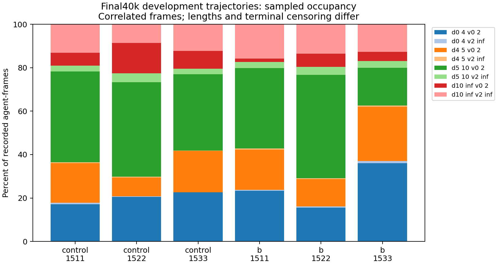

# Final40k saved-trajectory dwell and reward diagnosis

2026-11-05. Reviewed protocol/code pushed **ebaa9c9** to both branches before
first execution. CPU/NumPy audit exit0, all72 existing final development
trajectories. No weights, actor, learner, environment creation/step, new rollout,
training or sealed map was used. Primary results remain C[2,1,4], B[6,0,5]/12.

## Integrity and definitions

Separate summarizer verified183 input hashes, six completed artifact hashes,
72progress lines, JSONL/summary identity, six populations and reward-component
sums. Original14 training-source and both config hashes match run manifests.
All72 saved-action physics checks have maximum absolute position/velocity error0.
Prior A/Cevt/J/closest/occupancy checks pass. These are consistency checks, not
collision or policy certificates. All72 saved episodes have no collision.

Use post-step S_it=1[4<=||g_i-p_it||<10 and ||v_it||<0.5]. Reset is excluded
from occupancy/event predicates and initializes distance/velocity differences.
For h=.2s, Nsamples mean Nh sampled occupancy and(N-1)h endpoint span.
Thus25frames means5s occupancy count and4.8s endpoint span, without a
continuous-time residence proof. All bins, agent/event records and components
remain in JSON. Repeated frames/maps are correlated; training seeds are the
replication units.

## Every history

| Arm | Seed | Agent-frames | Near-stall frames (%) | Agent-maps with >=25-frame run /36 | Never-ball with run /total | Capture entries /exits |
|---|---:|---:|---:|---:|---:|---:|
| Control |1511|10932|5248 (48.01)|19|7/7|45/33|
| Control |1522|11688|4328 (37.03)|17|14/20|23/13|
| Control |1533|9123|3899 (42.74)|15|8/11|47/30|
| B |1511|8172|2925 (35.79)|7|2/6|52/31|
| B |1522|12600|2531 (20.09)|6|4/17|58/53|
| B |1533|8415|3007 (35.73)|11|4/4|29/5|

Among65never-ball agent-map records,39have a >=25-frame near-stall run,
48end in that predicate, and11491/22750post-step agent-frames meet it.
Longest run:299samples (59.8s occupancy,59.6s endpoint span). This describes
actual saved traces beyond closest-distance and replay-conditioned one-step
actor statistics. It does not establish hovering in a free corridor, an
attractor, an optimal reward exploit or a failure cause.

B's lower near-stall fractions coexist with its negative1522 pair:0/12success,
58capture entries and53exits. Smaller occupancy is not sufficient for success.
Captures are nonabsorbing; repeated entries are not independent successes.
Policy-dependent trajectories and successful early termination alter denominators.
Conditional never-ball populations are also policy-selected; no causal arm
effect or independent confidence interval follows.

## Formula-derived rewards, no logged-return reference

Ever-ball/capture memories reset False. Realized acceleration is(v_t-v_{t-1})/h
after speed projection. Reconstruct progress, living, squared acceleration,
undifferenced near reward, once-ever ball entry, signed capture change and
shared terminal reward. Common+50 remains50 after team averaging. Include
the last terminal transition; B is disabled during evaluation.

Mean raw gamma=.99 discounted team-mean components over all12episodes/history:

| Arm | Seed | Progress | Near | Acceleration | Capture change | Terminal | Total |
|---|---:|---:|---:|---:|---:|---:|---:|
| Control |1511|25.97172|13.68246|-1.19050|1.59367|4.08757|44.98660|
| Control |1522|28.02343|15.11548|-1.08556|1.57870|2.65077|46.63337|
| Control |1533|29.29665|13.64550|-1.31849|2.56322|9.21172|54.17509|
| B |1511|28.44343|12.67087|-1.36618|2.89537|10.45541|54.08951|
| B |1522|24.95754|13.95341|-1.16506|0.78675|0.00000|38.79112|
| B |1533|29.48878|14.27614|-0.74632|3.27318|10.33929|57.92065|

Living/first-ball/collision are included in total and retained in JSON, as are
all undiscounted/per-agent totals. These finite sums omit entropy/bootstrap.
**Logged evaluation-return reference validation is UNAVAILABLE for every map.**
The frozen writer saves no cumulative evaluation return; formula consistency
does not create one, and training return is not substituted. Component size
does not identify policy preference, optimality or reward dominance.

## Next hypothesis and artifacts

A next controlled method experiment must target joint success while retaining
approach and retention failures. Noise increases, reward-coefficient searches
and extending the completed40k runs are not justified by these diagnostics.
Primary literature already distinguishes low-speed arrival/time on goal; the
updated related-work/gap table records this boundary. This audit is descriptive
evidence hygiene, not a new control method. No next rollout/training is queued.

- Audit: `results/masac_v4_sync_40k_final_dwell_audit_20261105`, own manifest/status/completion.
- Separate verification/table/figure: `results/masac_v4_sync_40k_final_dwell_summary_20261105`.
- Commands/full logs: `WINDOWS_COMMAND_LEDGER_20261105.md`, Windows audit root `final_dwell*_console.log`.
- Reproduce with `scripts/audit_sync_final_trajectory_dwell.py`, then `scripts/summarize_sync_final_dwell.py`, fresh outputs only.
