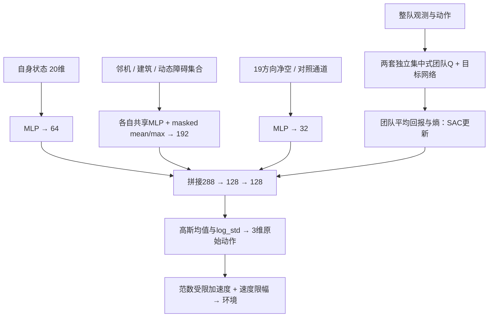

# MASAC V3：先冻结设计，再运行

2026-11-02。核心方向仍为 MASAC 多无人机三维路径规划。

## 问题和待验证 idea

距离小不一定危险：低速、空旷、可横移时仍有控制余量；距离大也不一定可避让：高速、制动能力低或侧面被建筑封住时，安全动作可能已很少。
因此候选问题是：**策略是否需要知道不同加速度方向还剩多少预测净空，而不只是当前距离或匀速预测碰撞时间？**

不能把“考虑加速度”或“短时预测”当创新：AVO已研究加速度受限碰撞避让；SCOPE已结合短时预览与策略学习和安全执行；DGPPO已考虑输入约束与离散安全学习。当前只是一个待证伪的轻量化设计，不声称首次提出。

固定19个控制探针（零加速度、6个坐标轴方向、12个面对角方向），均满足加速度范数限制。每个探针用与环境一致的速度限幅动力学向前模拟2s，得到对建筑、边界、其他无人机和动态障碍的最小预测净空 m_k。向量保留方向性，max(m_k)表示这些被测试动作中最好净空，正值比例表示离散动作储备。
这里不是连续可达集、CBF证书或全局可避让性；所有探针失败也不能证明无可行轨迹。邻机按恒速预测，不能保证其实际配合。

接入方式：19维向量经32维编码与几何观测一起进入Actor，不改奖励，不投影或替换Actor动作。通过Q梯度学习哪些方向储备与长期回报有关。先保留纯MASAC基线；后续再跑同容量同预算四组。候选未训练前不能宣称改善。

## 地图不是随机撒球

240×240×90m；25个规则地块的混合高度城区、20栋大足迹仓库及作业通道、24栋围绕中央开放区的园区。建筑尺寸/高度随地图种子变化但物理足迹不重叠；四个运动障碍沿道路巡行。道路、净空、边界与建筑共同影响避让选择。
每架独立进出航路点，分布在外围开放区，反向任务制造交会；每张图记录原始建筑、起终点及动态障碍历史。高度30–85m制造绕行/越顶选择；机场起降及真实测绘不在当前模型内。
地图不是越密越好：保留全失败场景，检查起终点净空，并在学习前用几何测试核查输入。这里只验证局部端点有效，不承诺存在全局可行路径。

## 网络：结构化输入，规模共享

Actor采用参数共享、去中心化执行。自身20维、最多5个邻机×7维、最近8栋建筑×7维、4个动态障碍×8维、19维机制通道，共162维。
自身MLP输出64；各类对象用小型共享MLP输出32，再做带mask的均值/最大池化，各64；机制MLP输出32。拼接288维→128→128→均值/log_std各3维。tanh Gaussian输出连续加速度。无GNN/Transformer。
Critic使用完整联合观测和动作，经每架128维共享编码、团队均值/最大池化，输出团队Q；两个独立Q与目标网络。使用团队平均奖励、团队平均log-prob，熵系数与该尺度一致。Replay按整队transition存储，Actor共享参数让3/4/6架推理接口一致；规模泛化仍需实验，不能仅凭共享就声称成立。
各组保留相同输入维度和相同参数量：standard机制通道全零；distance重复当前最小净空；prediction重复匀速2s预测净空；maneuver为19方向净空。不增加机制组奖励项。
所有Actor已经输入速度与amax，因此消融检验的是显式控制余量结构，而非偷偷增加动力学信息。

## 实验执行门槛

1. 先完成地图/动力学/碰撞/置换不变性/反向梯度测试。
2. 固定配置和源码快照，先进行短训练检查损失与权重更新，再启动Standard MASAC开发训练。
3. 训练终端每100步报告seed、步数、更新数、Actor/Critic loss、alpha、采样速度、耗时和ETA；每2000步保存checkpoint并评估。
4. 基线具备导航能力后再投入四组完整预算。若仍全部失败，先区分动力学/奖励/critic学习/地图可行性问题，不用机制掩盖基线失效。
5. 后续确认使用独立训练种子和新地图；CI以训练seed为单位，不能把同一模型几十张图当几十个独立训练重复。
6. 消融：同容量零通道、打乱19方向对应关系、固定amax错误模型、匀速预测；各项预算预先固定。

## 文献依据与差异边界

- AVO作者项目：https://gamma-web.iacs.umd.edu/AVO/ —— 加速度约束并非新概念。
- SCOPE正式页面：https://ijcai.org/proceedings/2026/7 —— 已有短时安全预览、融合Actor-Critic及CBF动作修正；官方源码链接 https://github.com/98177qdn/SCOPE 。本轮已核网页机制段，未运行其代码。
- DGPPO正式页面：https://proceedings.iclr.cc/paper_files/paper/2025/hash/b0916c29bc32d57e2c86a63e8f2df9f2-Abstract-Conference.html —— 已考虑输入约束；本轮仅核摘要，不冒充完整理论精读。

审稿风险：本方法可能仅是已有安全动作集的特征工程；19探针采样偏差；推理成本抵消收益；均值池化损失信息；同任务奖励和容量控制不足以证明普遍优越性。必须用实测回答，不能先写正面结论。

## 已实现参数量

Actor: 65350；双Critic合计: 195970。目标网络另保存一份双Critic；各消融组容量一致。

预测净空只使用与Actor相同的最近8栋建筑，且只在0.2s网格检查；因此连连续碰撞保证都不提供。环境终止使用连续线段检查，两个用途不混淆。

## 网络数据流

动作熵定义在tanh后、径向限幅前的原始3维动作空间；不把它称为执行加速度的精确熵。Critic读取联合局部观测，不拥有完整远处地图。最近邻建筑集合会变化，当前是无记忆策略，部分可观测性仍是局限。

## 当前进度查看

2026-11-02 后续诊断见 [诊断协议](MASAC_V3_DIAGNOSTIC_PLAN.md) 和 [结果报告](../MASAC_V3_DIAGNOSIS_20261102.md)。原始 20,000 步三个种子已全部完成，最终各 0/6；当前另目录受控续训至每种子总计 100,000 步，不改变本设计中的网络/奖励/环境。原始快照与结果保留。

`.venv/bin/python scripts/masac_v3_status.py --watch`

`tail -n 30 -F results/masac_v3_budget_20261102.log`

查看脚本只读日志，不会重复启动训练。工具环境无法找到Terminal应用，需在本机终端执行或双击scripts/watch_masac_v3.command。
父结果目录：results/masac_v3_baseline_20261102；当前续训目录：results/masac_v3_budget_20261102。查看器默认跟随 results/masac_v3_active_run.json。status.json 是实时训练记录，latest_evaluation.json 是最近已完成评估；只有 completion.json 存在才代表该批次所有训练种子完成。
