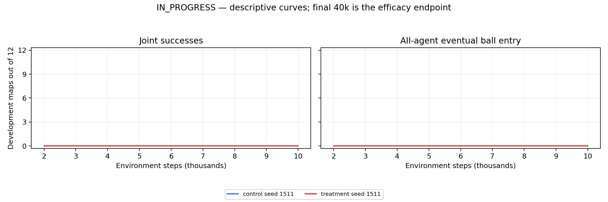

# Static B 40k development study

**IN_PROGRESS**

Three independent training seeds; 12 development maps are repeated measurements, not 36 independent training trials. No significance, safety, predictive-content or novelty claim. No sealed test or weights loaded.

No advancement decision is calculated. All six final completions, finite diagnostics and integrity checks are required.

## Latest observed development evaluations

| Arm | Seed | Step | Success /12 | Any ball /12 | All ball /12 | Mean max occupancy |
|---|---:|---:|---:|---:|---:|---:|
| control | 1511 | 10000 | 0 | 0 | 0 | 0.0 |
| control | 1522 | None | None | None | None | None |
| control | 1533 | None | None | None | None | None |
| treatment | 1511 | 10000 | 0 | 1 | 0 | 0.0 |
| treatment | 1522 | None | None | None | None | None |
| treatment | 1533 | None | None | None | None | None |

## Sampled learning diagnostics and completed-episode reward scale

Clip fractions and entropy/alpha below are sampled progress logs, not all updates. “pending final40k” means the final evidence is not due yet; it does not indicate nonfinite diagnostics. JSON finite_diagnostics_observed separately reports whether available learning samples are finite (null means no loss sample yet). Reward totals include completed episodes only; shaped training return is not a common cross-arm performance metric.

| Arm | Seed | Final 40k finite evidence | Critic clip fraction | Latest entropy | Latest alpha | Completed episodes | Base total | Shaping total |
|---|---:|---|---:|---:|---:|---:|---:|---:|
| control | 1511 | pending final40k | 1.0 | -2.675293445587158 | 0.024861719459295273 | 144 | -8258.370116313918 | 0.0 |
| control | 1522 | pending final40k | None | None | None | 0 | 0 | 0 |
| control | 1533 | pending final40k | None | None | None | 0 | 0 | 0 |
| treatment | 1511 | pending final40k | 1.0 | -2.4891278743743896 | 0.0250408798456192 | 148 | -5885.028355266329 | -12.453162380646454 |
| treatment | 1522 | pending final40k | None | None | None | 0 | 0 | 0 |
| treatment | 1533 | pending final40k | None | None | None | 0 | 0 | 0 |

Per-map exclusive failures, nonexclusive collision flags, occupancy, final distance/speed availability, common-grid AUC and peak-to-last drops are retained in analysis.json. Missing trajectory velocity is null.

